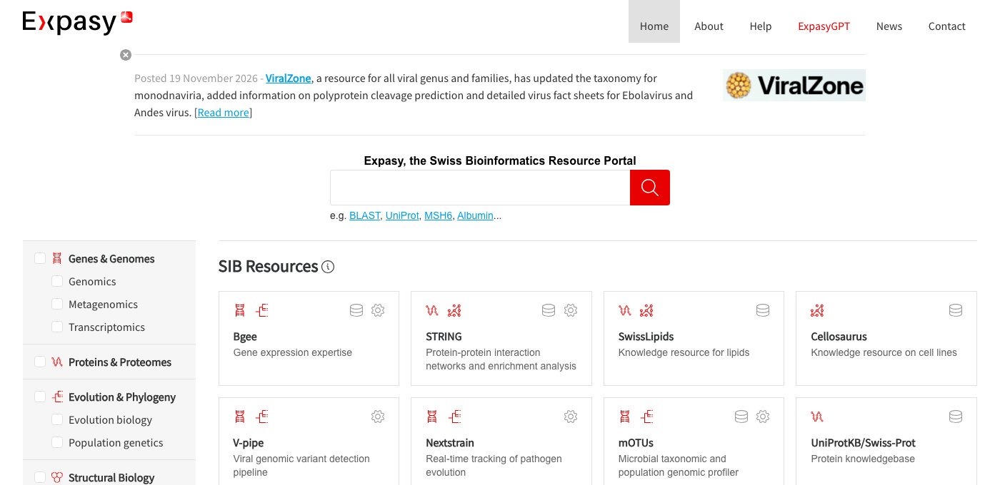
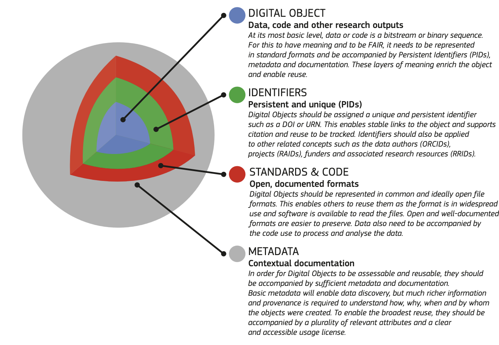
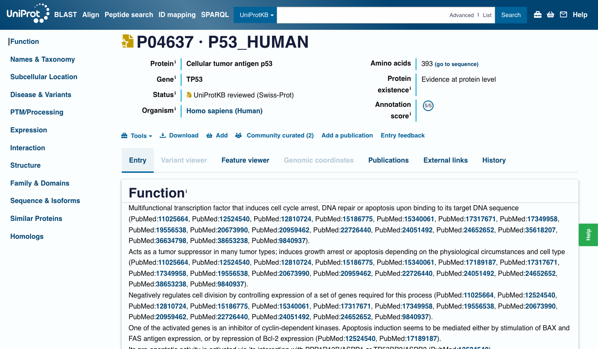
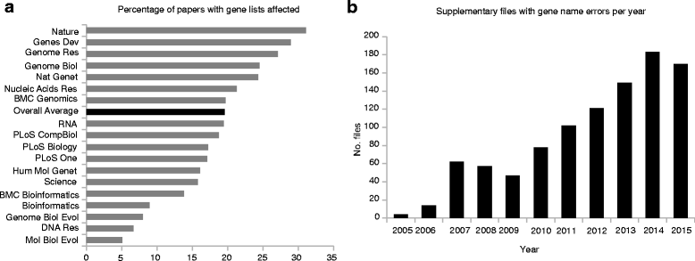
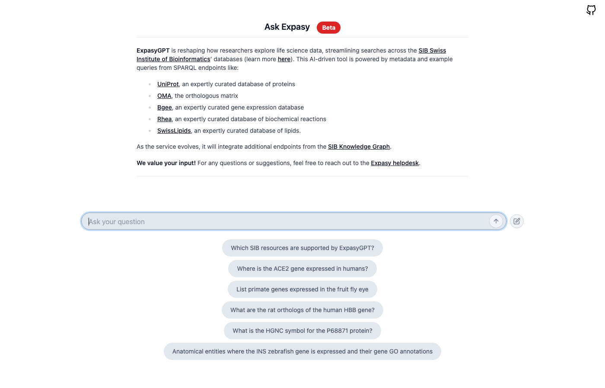
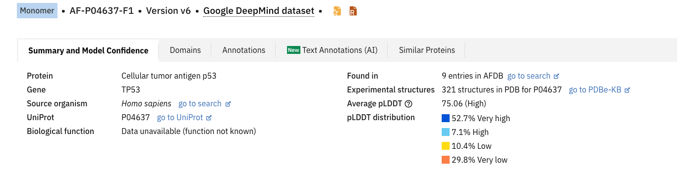
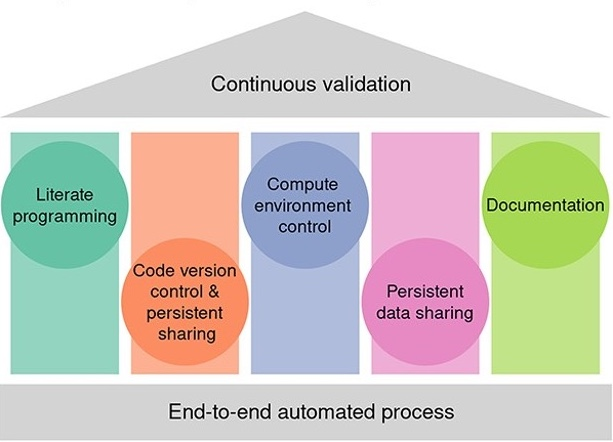
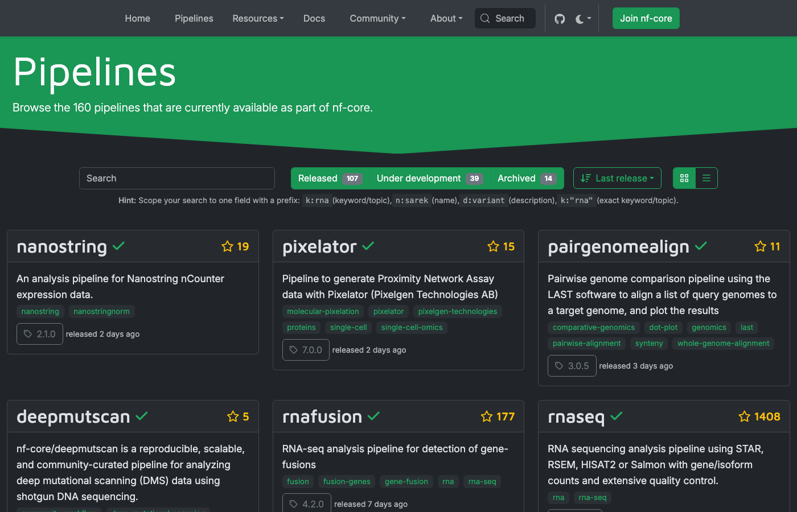
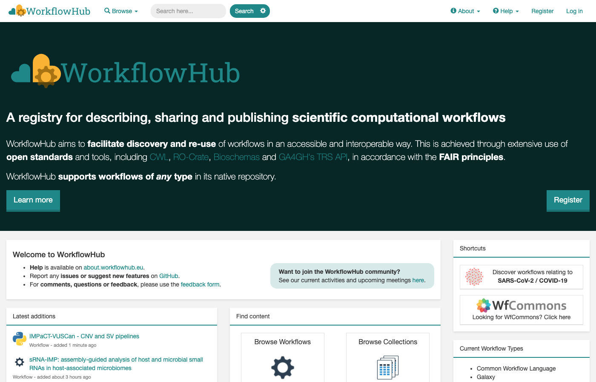
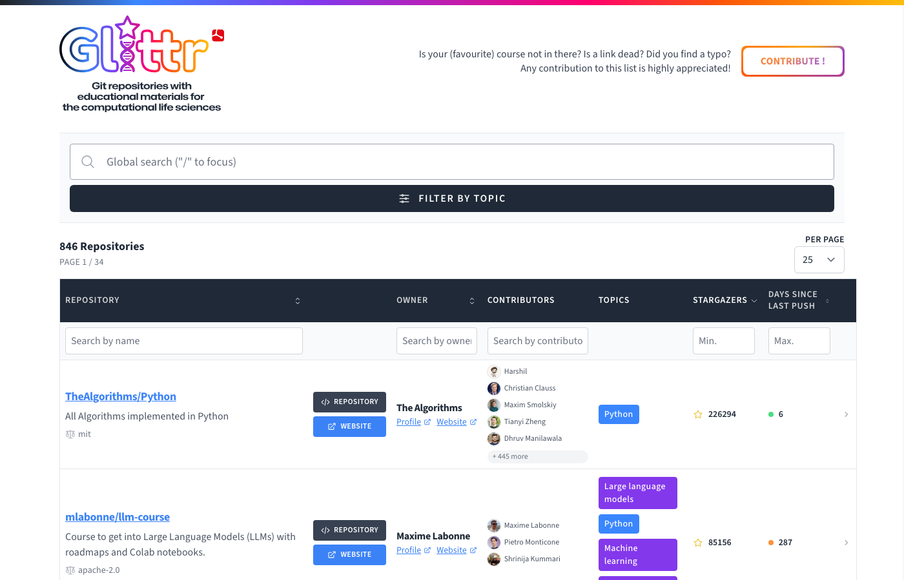

## About me

-   **Geert van Geest**
-   Training project manager **SIB Swiss Institute of Bioinformatics**
-   Co-leading the **ELIXIR Training Platform**
-   Developer and maintainer of **glittr.org**
-   2020-2025 trainer and bioinformatician at the Interfaculty Bioinformatics Unit, **University of Bern**
-   Have been teaching courses on omics data analysis, reproducibility and FAIR research

::: notes
Adapt to your current roles. Mention SIB Training and the ELIXIR training community.
:::

## Today

1.  **Shared data**: the foundation of bioinformatics, and the FAIR principles
2.  **FAIR data and AI**: why machine-actionable data matters more than ever
3.  **Reproducible analyses**: from scripts to workflows

*— break —*

4.  **AI in the bioinformatician's daily work**: LLMs, agents and MCP; opportunities and risks
5.  **Skills and training**: what does a bioinformatician need?

::: aside
Perspective: SIB Swiss Institute of Bioinformatics & ELIXIR
:::

## Learning outcomes

After this lecture you can:

::: incremental
-   **Explain** the FAIR principles and give examples of how SIB/ELIXIR resources implement them
-   **Argue** why FAIR, well-annotated data is a prerequisite for useful AI models
-   **Describe** the main building blocks of a reproducible analysis (code, environment, workflow, data)
-   **Explain** what an LLM, an agent and an MCP server are, and how they connect to databases
-   **Assess** opportunities and risks of using AI to write code and interpret results
-   **Reflect** on the skills you need as a (future) bioinformatician
:::

## Questions! {#vevox-start}

::: columns
::: {.column width="50%"}
-   Scan the QR code

-   OR: go to **vevox.app** and use the code: `183-757-288`
:::

::: {.column width="10%"}
:::

::: {.column width="40%"}
{width="100%"}
:::
:::

::: notes
Vevox Q1–Q5: study programme, programming experience, FAIR awareness, databases used, git experience. If few people use git, explain it briefly when it comes up (version control: a history of every change to your code, shareable via GitHub/GitLab). See vevox_questions.md.
:::

# Shared data: the foundation of bioinformatics

## Bioinformatics thrives on shared data

::: columns
::: {.column width="70%"}
::: incremental
-   Almost every analysis starts with **someone else's data**:
    -   reference genomes and annotations
    -   protein sequences and functions
    -   structures, expression, interactions, pathways
-   Your own experiment only becomes meaningful **in context** of what is already known
-   Shared data are the product of **decades of curation** by experts
-   Major scientific effort goes into building and maintaining **databases and software** 
:::
:::

::: {.column width="30%"}

:::
:::

## A Swiss story: Swiss-Prot and Expasy

::: columns
::: {.column width="58%"}
::: incremental
-   **1986**: Amos Bairoch starts **Swiss-Prot** in Geneva: a manually curated protein knowledgebase
-   **1993**: **Expasy** goes online, one of the first web servers in the life sciences
-   **1998**: **SIB** is founded
-   **2002**: Swiss-Prot + TrEMBL + PIR → **UniProt**
-   Today: still expert-curated, with evidence for every annotation
:::
:::

::: {.column width="42%"}
{style="border: 1px solid #ccc"}
:::
:::

::: aside
Screenshot: [expasy.org](https://www.expasy.org), 19 Nov 2026
:::

::: notes
Amos Bairoch started Swiss-Prot as a PhD student. A good example of how a single curated resource becomes global infrastructure.
:::

## SIB Swiss Institute of Bioinformatics

::: columns
::: {.column width="60%"}
-   **Non-profit**, national organisation for biological & biomedical data science
-   **~900 experts** in 28 partner institutions
-   Three pillars:
    -   **coordination** of Swiss bioinformatics
    -   **open databases & software**
    -   **centre of excellence**: expertise & services
:::

::: {.column width="40%"}
Some SIB resources:

-   **UniProtKB/Swiss-Prot**
-   **Expasy** (portal)
-   **SWISS-MODEL** (structures)
-   **STRING** (interactions)
-   **Bgee** (expression)
-   **OMA** (orthology)
-   **Rhea**, **SwissLipids**
-   **Cellosaurus** (cell lines)
:::
:::

::: aside
[sib.swiss](https://www.sib.swiss) (figures as of Nov 2026) · [expasy.org](https://www.expasy.org)
:::

::: notes
Tagline: "Data scientists for life". Figures: ~700 members from 28 institutional partners + ~200 employees at the SIB Hub. Partners serve academia, hospitals and industry. Mission (sib.swiss): "By unlocking the full value of data, the SIB Swiss Institute of Bioinformatics delivers positive impact for society." Vision: unlocking the potential of biological and biomedical data. SIB is also the Swiss ELIXIR node (next slide) and hosts the Centre for Pathogen Bioinformatics.
:::

## ELIXIR: a European infrastructure for life science data

> "ELIXIR's mission is to build a sustainable European infrastructure for biological information."

-   Intergovernmental organisation, since **2013**
-   **Nodes** in 20+ countries + EMBL-EBI; **SIB is the Swiss node**
-   Selects **Core Data Resources** with long-term value

::: aside
ELIXIR Scientific Programme 2019–2023, *F1000Research* (2019) · [elixir-europe.org](https://elixir-europe.org)
:::

::: notes
Several SIB resources are ELIXIR Core Data Resources and/or Global Core Biodata Resources (e.g. UniProt, STRING, SWISS-MODEL). Check the current lists before the lecture.
:::

## When data sharing makes a difference

::: incremental
-   **January 2020**: the first SARS-CoV-2 genome is shared publicly within days of sequencing
-   Within days, groups designed **diagnostic PCR tests** and **mRNA vaccine** candidates
-   Thousands of genomes followed, shared via INSDC (ENA/GenBank/DDBJ) and GISAID
-   In Switzerland: e.g. **wastewater surveillance** of variants (V-pipe, SIB/ETH)
:::

. . .

::: {.callout-tip}
Data are most valuable when **others** can find and use them — quickly, and with confidence.
:::

## But sharing alone is not enough

> "I put my data in the supplementary material, so it's shared."

::: incremental
-   Can anyone **find** it? (Is it indexed? Does it have an identifier?)
-   Can they **get** it? (Under which conditions? Will the link still work in 10 years?)
-   Can someone else or a computer **understand** it? (Formats, vocabularies, gene names?)
-   Are they **allowed and able** to reuse it? (License, provenance, methods?)
:::

## FAIR principles

::: columns
::: {.column width="40%"}
-   **F**indable
-   **A**ccessible
-   **I**nteroperable
-   **R**eusable

<br>

**For humans *and* machines**
:::

::: {.column width="60%"}

:::
:::

::: aside
Wilkinson et al. (2016) *Sci Data* 3:160018. <https://doi.org/10.1038/sdata.2016.18>

Image: European Commission, *Turning FAIR into reality*, 2018, <https://data.europa.eu/doi/10.2777/1524>
:::

## FAIR in a bit more detail

| | Key idea | Example |
|------|------------------------------|------------------------------|
| **F** | Globally unique, **persistent identifier**; rich metadata; indexed | DOI, UniProt accession `P04637` |
| **A** | Retrievable by identifier via a **standard protocol**; metadata stays available | HTTPS, REST API, authentication if needed |
| **I** | Shared **formats, vocabularies and ontologies** | FASTA, mmCIF, Gene Ontology, ChEBI |
| **R** | Clear **license**, **provenance**, community standards | CC BY 4.0, evidence codes, MIAME |

: {tbl-colwidths="[6,47,47]"}

## FAIR ≠ open

::: incremental
-   FAIR is about **how** data can be found and used — not whether everyone can download them
-   **"As open as possible, as closed as necessary"**
-   Sensitive human data can be FAIR:
    -   Metadata public and findable
    -   Access controlled, e.g. via a data access committee
    -   e.g. **European Genome-phenome Archive (EGA)**, **BioMedIT** / Swiss Personalized Health Network (SPHN)
:::

::: notes
Good place for the true/false vevox question "FAIR data must be open".
:::

## A UniProt entry: P04637 (p53)

{fig-align="center" height="480" style="border: 1px solid #ccc"}

::: aside
Screenshot: [uniprot.org/uniprotkb/P04637](https://www.uniprot.org/uniprotkb/P04637/entry), 19 Nov 2026
:::

::: notes
Point out: stable accession, reviewed (Swiss-Prot) status, annotation score, every statement backed by PubMed references (provenance), tabs for external links. Optional: open the live page.
:::

## FAIR in practice: a UniProt entry

::: columns
::: {.column width="50%"}
-   **F**: stable accession `P04637` (TP53), indexed and searchable
-   **A**: web page, REST API, FTP, SPARQL
-   **I**: annotations use **GO**, **ECO**, **ChEBI**; links to 100+ other databases
-   **R**: **CC BY 4.0** license, evidence and source for every annotation, versioned releases
:::

::: {.column width="50%"}
```bash
# human-readable
https://www.uniprot.org/uniprotkb/P04637

# machine-readable
curl "https://rest.uniprot.org/uniprotkb/P04637.json"

curl "https://rest.uniprot.org/uniprotkb/P04637.fasta"
```
:::
:::

## Interoperability: speaking the same language

::: incremental
-   **Ontologies**: controlled, structured vocabularies
    -   Gene Ontology, Uberon (anatomy), ChEBI (chemicals), Cell Ontology, ECO (evidence)
-   **Identifiers** that resolve: [identifiers.org](https://identifiers.org), [bioregistry.io](https://bioregistry.io)
    -   e.g. [`identifiers.org/uniprot:P04637`](https://identifiers.org/uniprot:P04637) → uniprot.org entry
-   **Standards** for formats and metadata: find them on [FAIRsharing.org](https://fairsharing.org)
-   **Linked data**: SIB resources expose **SPARQL endpoints** that can be queried *together* (federated queries)
:::

## Example: when interoperability fails

::: columns
::: {.column width="40%"}
-   Excel converts gene symbols to dates:
    -   `SEPT2` → `2-Sep`
    -   `MARCH1` → `1-Mar`
-   ~**20%** of papers with Excel gene lists contained such errors
-   2020: **HGNC renamed** the genes: `SEPTIN2`, `MARCHF1`
:::

::: {.column width="60%"}


::: {style="font-size: 0.5em"}
**a** % of papers with affected gene lists, per journal; **b** affected files per year
:::
:::
:::

::: aside
Ziemann et al. (2016) *Genome Biol* 17:177, Fig. 1 (CC BY 4.0); Bruford et al. (2020) *Nat Genet* 52:754–758
:::

## Machine-actionable: querying knowledge graphs

```sparql
PREFIX up: <http://purl.uniprot.org/core/>
PREFIX taxon: <http://purl.uniprot.org/taxonomy/>

SELECT ?protein ?name
WHERE {
  ?protein a up:Protein ;
           up:reviewed true ;
           up:organism taxon:9606 ;
           up:recommendedName/up:fullName ?name .
}
LIMIT 10
```

-   Run it at [sparql.uniprot.org](https://sparql.uniprot.org)
-   Similar endpoints for Bgee, OMA, Rhea, SwissLipids, Cellosaurus…
-   …and now with a **natural language interface**: [chat.expasy.org](https://chat.expasy.org) translates questions into SPARQL

## Ask Expasy: plain language → SPARQL

{fig-align="center" height="480" style="border: 1px solid #ccc"}

::: aside
Screenshot: [chat.expasy.org](https://chat.expasy.org), 19 Nov 2026
:::

::: notes
Possible live demo: ask "What are the rat orthologs of the human HBB gene?" and show the generated SPARQL query and its results. This links FAIR → AI: the LLM only works because the knowledge graphs are machine-actionable and well documented with example queries.
:::

# FAIR data and AI

## AI runs on data

::: columns
::: {.column width="55%"}
::: incremental
-   **AlphaFold** (Nobel Prize 2024) was trained on the **Protein Data Bank**
    -   since **1971**, >200,000 curated structures
    -   predictions shared FAIRly in **AlphaFold DB**
-   **Protein language models** (e.g. ESM) are trained on **UniProt**
:::
:::

::: {.column width="45%"}
**p53 (TP53)** in AlphaFold DB:

{style="border: 1px solid #ccc"}
:::
:::

. . .

::: {.callout-tip}
Decades of **open, curated, standardised** data made these breakthroughs possible.
:::

::: aside
Screenshot: [alphafold.ebi.ac.uk/entry/AF-P04637-F1](https://alphafold.ebi.ac.uk/entry/AF-P04637-F1), 19 Nov 2026
:::

::: notes
Screenshot: p53 in AlphaFold DB, linked to UniProt P04637 and 321 experimental PDB structures, with per-residue confidence (pLDDT); note ~30% "very low" confidence: the disordered regions of p53. Other examples of models built on shared data: cell atlases, variant effect predictors, LLMs.
:::

## Why AI needs FAIR data

| FAIR | Why it matters for AI |
|-----|------------------------------------------------|
| **Findable** | You can only train on data you can find — at scale |
| **Accessible** | Programmatic access (APIs) instead of manual downloads |
| **Interoperable** | Combining datasets requires shared formats, identifiers and ontologies |
| **Reusable** | Licenses, provenance and quality annotations decide what is *allowed* and *trustworthy* to use |

: {tbl-colwidths="[20,80]"}

## Garbage in, garbage out

::: incremental
-   **Annotation errors propagate**: automatic annotation based on wrongly annotated entries
-   **Data leakage**: homologous proteins in training *and* test set → overly optimistic performance
-   **Missing metadata**: batch, protocol, tissue unknown → models learn the wrong signal
:::

. . .

-   Curated resources with **evidence codes** (e.g. Swiss-Prot) are especially valuable for AI


## Question

{fig-align="center" height="480"}

::: notes
Vevox Q6–Q9: Swiss resource, FAIR ≠ open, what makes data AI-ready, and a guess for the next slide (share of AI-ready microbiome studies). Reveal the answer on the next slide.
:::

## Shared ≠ reusable: a decade-scale audit

::: incremental
-   **2,896** human microbiome studies (2012–2025), checked by hand
-   Only **37%** pointed to sequence data that could actually be accessed
-   Only **5.9%** deposited per-sample **disease, age and sex**
-   → **85.5%** of ~720,000 samples cannot be reused for meta-analysis without contacting the authors 
-   **No improvement** over the decade; high-impact journals: more data deposited, *not* better annotated
:::

. . .

::: {.callout-important}
Available ≠ reusable. The **metadata**, with standards (MIxS) and ontologies (e.g. MONDO for disease), make data AI-ready.
:::

::: aside
Degregori et al. (2026) *iMeta* e70192, [doi.org/10.1002/imt2.70192](https://doi.org/10.1002/imt2.70192)
:::

::: notes
"AI-ready" in the paper: FAIR plus structured, machine-actionable, harmonised per-sample metadata that can be ingested without manual curation or author contact. Deposit improved slightly over time; per-sample annotation did not. Authors' recommendations: reviewers/editors check the accession for per-sample metadata (they note this takes a single LLM prompt against the ENA API, see the agents/MCP part later), richer required fields at SRA/ENA/DDBJ, citable data submissions.
:::

# Reproducible analyses

## Reproducibility crisis?

::: incremental
-   Survey of 1,576 researchers: **>70%** failed to reproduce someone else's experiment, **>50%** failed to reproduce their *own*
-   Bioinformatics is no exception: **85.5%** of public human microbiome samples cannot be reused without contacting the authors
-   Computational analyses *should* be the easiest to reproduce — same data, same code, same result?
:::

::: aside
Baker (2016) *Nature* 533:452–454; Ioannidis et al. (2009) *Nat Genet* 41:149–155; Degregori et al. (2026) *iMeta* e70192
:::

## Reusability is even better

-   *Reproducibility:* results should be achieved again with a high degree of reliability when the analysis is replicated
-   *Reusability:* the extent to which existing digital objects can be used for other purposes than their initial purpose

. . .

::: {.callout-tip}
Reproducible analyses let others **verify** your work. Reusable analyses let others **build** on it.
:::

## Why can a reusable analysis be difficult?

::: columns
::: {.column width="60%"}
::: incremental
-   Short term goal: get your results ASAP
-   Mid term goal: publish
-   Long term goal: re-use and stand on the shoulders of giants!
-   **Most important collaborator: yourself in 6 months**
:::
:::

::: {.column width="40%"}

:::
:::

------------------------------------------------------------------------

::: columns
::: {.column width="50%"}
### Software

-   Developed continuously
-   Developed by teams
-   Developed for others
-   Data is input
-   Defined interface
-   Extensive testing
-   **Reusability is enforced**
:::

::: {.column width="50%"}
### Data analysis

-   Developed 'once'
-   Usually single researcher
-   Developer = user
-   Developed for single dataset
-   Users interact with code
-   Mistakes can go undetected
-   **Reusability is a choice**
:::
:::

::: aside
Slide from: Roland Krause, ELIXIR-LU
:::

## Five pillars of reproducible research

{fig-align="center"}

::: aside
Ziemann et al. (2023) *Brief Bioinform* 24(6):bbad375, <https://doi.org/10.1093/bib/bbad375>
:::

## The toolbox

| Pillar | Tools |
|---------------------|------------------------------------------|
| Literate programming | **Quarto**, Jupyter, R Markdown |
| Version control & sharing | **git**, GitHub/GitLab |
| Compute environment | **conda**/Bioconda, renv, **containers** (Docker, Apptainer), BioContainers |
| Persistent data sharing | **Zenodo** (DOI), ENA, PRIDE, … |
| Documentation | README, `CITATION.cff`, comments, metadata |

: {tbl-colwidths="[35,65]"}

## Workflow managers

::: columns
::: {.column width="55%"}
-   Chain tools into a **pipeline** that runs end-to-end
-   Handle software environments, parallelisation, HPC/cloud
-   Resume after failure; record what ran
-   Examples: **Nextflow**, **Snakemake**, **Galaxy** (graphical)
:::

::: {.column width="45%"}
```{mermaid}
%%{init: {"flowchart": {"padding": 30, "rankSpacing": 18}}}%%
flowchart TD
  A[FASTQ] --> B[QC]
  B --> C[Alignment]
  C --> D[Quantification]
  D --> E[Differential expression]
  E --> F[Report]
```
:::
:::

## Reproducible workflows accelerate science

::: incremental
-   **nf-core**: community-curated Nextflow pipelines — reviewed, tested, versioned, documented
    -   one RNA-seq pipeline, thousands of users, constantly improved
-   **Galaxy**: reproducible analyses without programming, with a large training network
-   ELIXIR **WorkflowHub**: register and cite workflows (with DOIs, RO-Crate metadata)
-   ELIXIR **bio.tools**: registry of >30,000 tools with standardised (EDAM) descriptions
:::

. . .

-   Don't reinvent the wheel: **reuse, contribute, cite**

## Look for a workflow before you write one

::: columns
::: {.column width="50%"}
{style="border: 1px solid #ccc"}

[nf-co.re/pipelines](https://nf-co.re/pipelines): 160 community pipelines; `rnaseq` alone has >1,400 GitHub stars
:::

::: {.column width="50%"}
{style="border: 1px solid #ccc"}

[workflowhub.eu](https://workflowhub.eu): registry for workflows of any type (Nextflow, Snakemake, Galaxy, CWL…)
:::
:::

::: aside
Screenshots, 19 Nov 2026
:::

## FAIR also applies to software and analysis

-   Research software and analysis scripts are research output, just like data
-   **FAIR4RS** principles: identifiers for software versions, rich metadata, standard formats, license
-   In practice:
    -   Code on GitHub/GitLab with a **license**
    -   Releases archived on **Zenodo** with a **DOI**
    -   Registered in **bio.tools** / **WorkflowHub**

::: aside
Barker et al. (2022) Introducing the FAIR Principles for research software. *Sci Data* 9:622
:::

## Question

{fig-align="center" height="480"}

::: notes
Vevox Q10–Q11: rerun analysis → different results; which tool is a workflow manager.
:::

# Break

# AI in the bioinformatician's daily work

## Question

{fig-align="center" height="480"}

::: notes
Vevox Q12–Q13: how do you use AI tools for coding; do you check AI-generated code.
:::

## How AI is changing our work

::: incremental
-   **Writing code**: autocompletion, chat assistants, **coding agents** that edit and run whole projects
-   **Exploring data**: "plot the PCA and colour by batch" in natural language
-   **Querying databases**: natural language → SPARQL/SQL/API calls (e.g. chat.expasy.org)
-   **Interpreting results**: summarising gene lists, literature, pathways
-   **Learning**: explaining code, error messages, concepts
:::

. . .

To use these tools responsibly, you need to know **what they are**: an **LLM**, an **agent**, and an **MCP server**.

## What is a large language model (LLM)?

::: columns
::: {.column width="55%"}
::: incremental
-   A neural network trained to **predict the next token** (≈ word piece) given the text so far
-   Trained on enormous amounts of text: books, web pages, code, scientific papers
-   Generates text by repeatedly **sampling** the next token
-   Examples: GPT, Claude, Gemini, Mistral, Llama, Qwen
:::
:::

::: {.column width="45%"}
*"The tumour suppressor TP53 encodes the protein …"*

| next token | probability |
|------------|------------:|
| p53        | 0.81        |
| that       | 0.07        |
| known      | 0.05        |
| …          | …           |

::: {style="font-size: 0.6em"}
*Illustrative numbers*
:::
:::
:::

::: notes
Key intuition: an LLM produces the most plausible continuation, not the true one. Sampling explains why the same prompt can give different answers.
:::

## From autocomplete to assistant to agent

| Era | Technique | Behaviour |
|-------------|--------------------------------|--------------------------------|
| **Pre-training** (2018–2022) | Self-supervised next-token prediction on huge corpora | Advanced autocomplete |
| **Alignment** (2022–2023) | Fine-tuning on instructions + human feedback (RLHF) | Helpful conversational assistant (ChatGPT, Nov 2022) |
| **Tool use** (2023–now) | Function calling, agentic fine-tuning | Writes code and **calls tools** when it hits a limitation |

: {tbl-colwidths="[22,40,38]"}

::: aside
Adapted from V. Emonet, *Coding agents for biodata exploration*, SIB, [sib-swiss/llm-biodata-training](https://github.com/sib-swiss/llm-biodata-training)
:::

## What an LLM is (not)

::: columns
::: {.column width="50%"}
**Good at**

-   Language: summarising, explaining, translating
-   Code in well-known languages and libraries
-   Stable, long-lived standards (*"What does HTTP 404 mean?"*)
:::

::: {.column width="50%"}
**Not good at**

-   Being a **database**: knowledge is compressed, frozen at a **cutoff date**, and without **provenance**
-   Fast-moving libraries (*"the function for Y in the latest release of X"*)
-   Saying *"I don't know"* → **hallucinations**
:::
:::

. . .

::: {.callout-important}
Treat an LLM as a **human–computer interface**, not as a trustworthy knowledge base. Research needs **provenance**: connect it to trusted databases.
:::

## What is an agent?

> **An LLM agent runs tools in a loop to achieve a goal**

::: columns
::: {.column width="50%"}
```{mermaid}
%%{init: {"flowchart": {"padding": 30}}}%%
flowchart TD
  U["Your question / task"] --> L["LLM decides<br/>next step"]
  L -->|tool call| T["Run a tool:<br/>bash, Python, API, database"]
  T -->|result| L
  L -->|done| A["Answer / changed files"]
```
:::

::: {.column width="50%"}
::: incremental
-   Tools: run a shell command, read/edit files, search the web, query a database…
-   The LLM **sees the results** and decides what to do next
-   Plus: planning (to-do lists), memory, summarising long contexts
:::
:::
:::

::: aside
Definition: Simon Willison; see also [sib-swiss/llm-biodata-training](https://github.com/sib-swiss/llm-biodata-training)
:::

## The harness: same model, different powers

A **harness** is everything around the model that turns it into an agent: the loop, the tools, the files it can see, the permissions.

| Harness | Sees | Can do |
|-----------------------|-----------------------|-----------------------------|
| **Chat web app** (ChatGPT, Claude.ai, Le Chat) | Uploaded files | Web search, sandboxed code, remote tools |
| **Coding agents** (Claude Code, Codex, Copilot, Cursor, OpenCode) | Your project, your file system | Run any command, edit code, install software |
| **Autonomous / remote agents** | Files, shared drives | Run unattended, scheduled jobs |

: {tbl-colwidths="[30,25,45]"}

. . .

::: {.callout-warning}
More power means more capability **and** more risk.
:::

## How does an agent talk to a database?

::: incremental
-   Every tool used to need custom glue code for every AI application
-   **MCP — Model Context Protocol** (2024): an open standard to connect LLM applications to tools and data
-   Think of it as a **"USB-C port for AI"**: write a server once, use it from any client
-   An MCP server exposes:
    -   **tools**: typed functions the LLM can call, e.g. `uniprot_search(query, organism)`
    -   **resources**: data to read, e.g. a UniProt entry
    -   **prompts**: reusable templates
:::

::: aside
[modelcontextprotocol.io](https://modelcontextprotocol.io)
:::

## An MCP server is just a well-described function

```python
from mcp.server.fastmcp import FastMCP
import requests

mcp = FastMCP(name="Biodata MCP")

@mcp.tool()
def uniprot_search(query: str, organism: str = "Homo sapiens",
                   max_results: int = 5) -> dict:
    """Search reviewed UniProt (Swiss-Prot) entries by gene name,
    function or keyword, e.g. "TP53" or "kinase AND DNA repair"."""
    params = {"query": f"{query} AND organism_name:{organism} AND reviewed:true",
              "format": "json", "size": max_results}
    r = requests.get("https://rest.uniprot.org/uniprotkb/search", params=params)
    return r.json()

mcp.run(transport="streamable-http")
```

-   The LLM only sees the **name, docstring and parameters**, not the code
-   It wraps a **FAIR API**: MCP is only as good as the data behind it

::: aside
Simplified from [sib-swiss/llm-biodata-training](https://github.com/sib-swiss/llm-biodata-training) (MIT license)
:::

::: notes
Optional live demo (~5 min): connect https://mcp.string-db.org/ or https://chat.expasy.org/mcp/ to a chat app (Le Chat, ChatGPT, Claude) and ask the TP53 question. Show which tool was called and with which arguments.
:::

## MCP servers for life science data

| Server | URL | What it does |
|--------------------|--------------------------------|--------------------------------|
| **Expasy** (SIB) | `https://chat.expasy.org/mcp/` | Writes and runs SPARQL over UniProt, Bgee, OMA, Rhea, … |
| **STRING** (SIB & partners) | `https://mcp.string-db.org/` | Protein–protein interaction networks, enrichment |
| **Registry** | [biocontext.ai/registry](https://biocontext.ai/registry) | Overview of biomedical MCP servers |

: {tbl-colwidths="[22,38,40]"}

```bash
# e.g. add STRING to a coding agent
claude mcp add stringdb --transport http https://mcp.string-db.org/
```

. . .

::: {.callout-tip}
**FAIR data → APIs → MCP → agents.** The decades of investment in FAIR, machine-actionable resources is what makes this possible.
:::

::: notes
Callback to the microbiome audit (Degregori et al. 2026): the authors propose that reviewers check whether an accession has per-sample metadata, which "is easily accessible with a single LLM prompt that will directly interact with ENA's API". Agents + FAIR APIs can help enforce FAIR, but only if the metadata are there.
:::

## Question

{fig-align="center" height="480"}

::: notes
Vevox Q14–Q15: what is an agent; what does an MCP server do.
:::

## Opportunities

::: incremental
-   **Speed**: boilerplate, plotting, file parsing in seconds
-   **Lower barrier**: wet-lab biologists can do more of their own analysis
-   **Better practices for free?** AI can write tests, documentation, workflows, containers
-   **Translation**: R ↔ Python, script → Nextflow pipeline
-   **Access to FAIR data** through natural language
:::

## Risks to rigour and understanding

::: incremental
-   **Plausible but wrong**: code runs, output looks reasonable, analysis is wrong
-   **Hallucinations**: non-existent functions, parameters, packages, references, gene functions
    -   attackers register hallucinated package names (*"slopsquatting"*)
-   **Supply chain**: malicious MCP servers or skills can steal credentials, like any pip/npm package
-   **Hidden decisions**: defaults for normalisation, filtering, statistics you never chose
-   **Non-determinism**: same prompt, different code; models change over time
-   **Privacy**: uploading patient data to a cloud service
-   **Deskilling**: you can't review what you don't understand
:::

## Human-directed vs. blind trust

::: columns
::: {.column width="50%"}
**Human-directed** ✅

> "I used Claude Code and Codex for the translation. This was **human-directed, not autonomous** code generation. I decided what to port, in what order, and what the Rust code should look like. It was **hundreds of small prompts**…"

— Ladybird browser, [ladybird.org/posts/adopting-rust](https://ladybird.org/posts/adopting-rust)
:::

::: {.column width="50%"}
**Blind trust** ❌

> "I didn't write a single line of code […] I just had a vision for the technical architecture, and AI made it a reality"

→ database credentials exposed to every visitor ([Wiz, 2026](https://www.wiz.io/blog/exposed-moltbook-database-reveals-millions-of-api-keys))

→ an agent with too many permissions **deleted a production database** ([The Guardian, 2026](https://www.theguardian.com/technology/2026/apr/29/claude-ai-deletes-firm-database))
:::
:::

::: aside
Examples from V. Emonet, [sib-swiss/llm-biodata-training](https://github.com/sib-swiss/llm-biodata-training)
:::

## Spot the problem

```r
# RNA-seq read counts: genes x samples
counts <- read.csv("counts.csv", row.names = 1)
counts <- counts[rowSums(counts) > 10, ]   # remove lowly expressed genes

ctrl <- grepl("ctrl", colnames(counts))
trt  <- grepl("trt",  colnames(counts))

pvals <- apply(counts, 1, function(x) t.test(x[trt], x[ctrl])$p.value)
de_genes <- names(pvals)[pvals < 0.05]
cat("Found", length(de_genes), "differentially expressed genes\n")
```

. . .

-   Runs without errors, gives a nice number of "DE genes"…
-   …but: no **library size normalisation**, a **t-test on raw counts** with few replicates, and **no multiple testing correction**

::: notes
Ask Vevox Q16 first, then reveal. With 20,000 genes and p < 0.05 you expect ~1,000 false positives by chance alone. Tested on simulated data with NO true differences (2,000 genes, 3 vs 3 samples): the code happily reports 69 "DE genes". Proper tools: DESeq2, edgeR, limma-voom, with adjusted p-values (p.adjust / padj).
:::

## Feeling productive ≠ being productive

-   Randomised trial with experienced open-source developers (2025):
    -   with AI tools they were **19% slower**
    -   but *believed* they were **~20% faster**
-   Today's tools are better and the evidence keeps changing, but the lesson stays:

. . .

::: {.callout-important}
Our **perception** of AI's help is not reliable. **Verify** — just like you verify a lab result.
:::

::: aside
Becker et al. (2025) METR, arXiv:2507.09089
:::

## Working with agents: do's and don'ts

::: columns
::: {.column width="50%"}
**Do**

-   **Commit** before every change, so you can `git diff` and revert
-   Give it a **target**: tests that must pass, known answers
-   Keep prompts **small and scoped**
-   Give it **context**: the actual error, the relevant docs
-   Prefer tools returning **live data** (MCP, APIs) over recalled "knowledge"
:::

::: {.column width="50%"}
**Don't**

-   Skip reading the code and running the tests
-   Let it take **irreversible actions** unsupervised (deleting data, modifying scripts)
-   Grant broad permissions you don't understand
-   Treat it as a **knowledge oracle**: cross-check biological claims in UniProt, Ensembl, PubMed
:::
:::

::: aside
Adapted from V. Emonet, [sib-swiss/llm-biodata-training](https://github.com/sib-swiss/llm-biodata-training)
:::

## AI and reproducibility

::: incremental
-   A prompt is **not** a reproducible method — the **code** is the research artefact
-   Commit AI-generated code to **git** like any other code; review the diff
-   Run inside the same **environments** and **workflows** as before
-   Test on data where you **know the answer** (positive/negative controls)
-   **Document** where and how AI was used (journals and funders increasingly ask)
-   **You** remain accountable for every line
:::

::: aside
European Commission (2024) *Living guidelines on the responsible use of generative AI in research*
:::

## FAIR + reproducibility make AI safer

-   AI agents work best with **well-documented APIs, standard formats and ontologies** → FAIR
-   AI-written code is easier to trust inside **version control, tests, containers and workflows** → reproducibility
-   Curated knowledge bases give AI **ground truth** to check against → fewer hallucinations

. . .

::: {.callout-tip}
The practices from the first half of this lecture are what make AI useful in the second half.
:::

# Skills and training

## What does a bioinformatician need?

::: columns
::: {.column width="50%"}
**Still essential**

-   Biology: asking the right question
-   Statistics and study design
-   Programming & data management (FAIR)
-   Critical thinking: *is this plausible?*
-   Communication & collaboration
:::

::: {.column width="50%"}
**Increasingly important**

-   **Reviewing** code and results you didn't write
-   Breaking problems into clear steps
-   Software habits: git, tests, environments
-   Knowing the **limits** of models and data
-   Responsible use: privacy, licenses, ethics
:::
:::

::: aside
Bioinformatics core competencies: Mulder et al. (2018) *PLoS Comput Biol* 14(2):e1005772
:::

## Learning in the age of AI

::: incremental
-   AI can be an excellent **tutor**: explain code, error messages, concepts
-   But **learning requires effort**: if AI does the thinking, you don't learn
-   Use AI to **understand faster**, not to **skip understanding**
-   Rule of thumb: *could you explain and defend this code to a reviewer?*
:::

## Training: SIB and ELIXIR

::: columns
::: {.column width="50%"}
**SIB Training**

-   [sib.swiss/training](https://www.sib.swiss/training): courses from beginner to advanced
-   e.g. RNA-seq, single-cell, reproducible research, [agentic AI & MCP](https://github.com/sib-swiss/llm-biodata-training)
-   Materials openly available (and FAIR!)
-   [glittr.org](https://glittr.org): training material on GitHub/GitLab
:::

::: {.column width="50%"}
**ELIXIR & community**

-   [TeSS](https://tess.elixir-europe.org): ELIXIR training portal
-   [RDMkit](https://rdmkit.elixir-europe.org): research data management guidance
-   Galaxy Training Network
-   The Carpentries
:::
:::

## Training materials should be FAIR too

::: columns
::: {.column width="50%"}
-   Openly licensed, versioned, with a DOI
-   Described with metadata (Bioschemas) → findable via TeSS
-   Reusable by other trainers: adapt, improve, contribute back

. . .

-   Example: [reproducible-analysis-training](https://sib-swiss.github.io/reproducible-analysis-training): Quarto, GitHub, Zenodo DOI
:::

::: {.column width="50%"}
{style="border: 1px solid #ccc"}

[glittr.org](https://glittr.org) (SIB): 846 Git repositories with training material, searchable by topic
:::
:::

::: aside
Garcia et al. (2020) *PLoS Comput Biol* 16(5):e1007854 · Screenshot 19 Nov 2026
:::

## Question

{fig-align="center" height="480"}

::: notes
Vevox Q17–Q18: open word cloud on skills, and the end-of-lecture check (repeat of Q3/Q7 style).
:::

## Take-home messages

::: incremental
1.  Bioinformatics stands on **shared, curated data** (SIB, ELIXIR)
2.  **FAIR**: for humans *and* machines; FAIR ≠ open
3.  **FAIR, well-annotated data** is a prerequisite for AI
4.  Reproducible: **code, environment, workflow, data, docs**
5.  **LLM** predicts text · **agent** runs tools in a loop · **MCP** connects it to data
6.  AI speeds up coding, but **you** remain responsible
7.  Invest in **fundamentals**: they let you use AI well
:::

## Thank you!

::: columns
::: {.column width="60%"}
-   Questions?
-   Slides: *add link*
-   SIB Training: [sib.swiss/training](https://www.sib.swiss/training)
-   ELIXIR: [elixir-europe.org](https://elixir-europe.org)
:::

::: {.column width="40%"}

:::
:::
